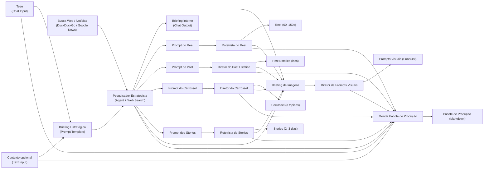

# Fábrica de Conteúdo Financeiro — Reel + Post + Carrossel + Stories

Fluxo Langflow que recebe **uma tese** de economia, finanças, investimentos ou notícias e devolve **quatro peças irmãs**, todas nascidas do mesmo briefing:

| Peça | Formato | O que entrega |
|---|---|---|
| **Reel** | 60–150s (máx. 180s) | Gancho + ganho inicial, tensão, virada, prova, payoff, loop, direção, atmosfera, recursos visuais/textuais/orais/sonoros e legenda |
| **Post estático** | 1080×1350 (4:5) | Isca de atenção com headline, copy da imagem, legenda, CTA e teste A/B |
| **Carrossel** | 6–8 slides | Capa + exatamente 3 tópicos curtos + síntese + CTA, com legenda, hashtags e design |
| **Stories** | 2–3 dias, 3–5 frames/dia | Sequência com enquete/quiz/caixinha, prova, CTA e ponte para a próxima tese |
| **Prompts Visuais** | Por asset necessário | Prompts detalhados em inglês, prontos para `gpt-image-2.5-sunburst`, com composição, safe zones e parâmetros da API |
| **Pacote de Produção** | Markdown | Briefing, quatro formatos, prompts visuais e checklist em um bloco pronto para arquivar |

O fluxo é pensado para uma cadência de **2–3 teses por semana**. Cada tese rende um pacote completo; os Stories preenchem os dias entre uma tese e outra.

## Estrutura narrativa

Todas as peças seguem o mesmo arco:

```text
Gancho + ganho inicial → Resposta esperada → Surpresa (virada + mecanismo)
→ Satisfação de expectativa (prova + entrega) → CTA
```

- **Gancho + ganho inicial**: promessa específica nos primeiros 1–3 segundos do Reel, no primeiro frame dos Stories ou na headline do post.
- **Resposta esperada**: o que o público provavelmente pensa. Gera identificação antes da virada.
- **Surpresa**: o mecanismo contraintuitivo que contraria a resposta esperada.
- **Satisfação**: a prova, os passos e o fechamento do loop aberto no gancho.
- **CTA**: uma ação única, específica e ligada ao ganho.

## Arquitetura



São **um pesquisador-estrategista + quatro roteiristas + um diretor de prompts visuais** (pipeline multiagente determinístico). O estrategista fixa o ângulo, pesquisa fatos e notícias e registra as fontes; os roteiristas e o diretor visual recebem o mesmo briefing.

## Configuração e primeiro uso

### Abrir ou importar o fluxo

- **Na instância Langflow já usada neste projeto:** atualize/recarregue o navegador e abra **Fábrica de Conteúdo Financeiro**. O fluxo existente já foi atualizado; não o importe de novo para não criar uma cópia.
- **Em outra instância:** na tela de Projects/flows, use o botão de upload na barra lateral ou arraste `Fabrica de Conteudo Financeiro.json` para a lista de fluxos. Não solte o arquivo dentro de outro canvas aberto: isso pode inserir os nós no fluxo em edição em vez de criar um fluxo novo.

### Configurar os modelos de texto

1. Abra o fluxo no editor e selecione o nó **Pesquisador-Estrategista**. Escolha um modelo com **tool calling**, pois ele usa a ferramenta de busca.
2. Selecione os modelos dos quatro nós roteiristas: **Roteirista do Reel**, **Diretor do Post Estático**, **Diretor do Carrossel** e **Roteirista de Stories**.
3. Selecione um modelo no **Diretor de Prompts Visuais**. Ele não precisa de tool calling; deve seguir instruções longas e produzir prompts detalhados. Pode usar o mesmo modelo dos roteiristas.
4. Configure a chave do provider no Langflow, em **Settings → Providers** (o nome do menu pode variar por versão), ou no campo **API Key** dos nós de modelo. Evite colar chaves nos prompts, no contexto, no README ou no JSON exportado.
5. Salve o fluxo. A busca web não exige chave própria no setup padrão.

> A chave do provider de texto no Langflow não é automaticamente disponibilizada a um script executado no seu computador. A geração de imagem via OpenAI API abaixo usa `OPENAI_API_KEY` no ambiente local.

### Executar uma tese

1. Abra o **Playground** do fluxo.
2. Digite uma tese específica em português no campo de entrada. Exemplo: `A inflação caiu, mas o custo do crédito continua alto para as famílias.`
3. No nó **Contexto (opcional)**, informe marca, público, tom de voz, produto e provas disponíveis. Não invente ou inclua credenciais.
4. Execute. Confira as sete saídas: **Briefing (interno)**, **Reel**, **Post Estático**, **Carrossel**, **Stories**, **Prompts Visuais (Sunburst)** e **Pacote de Produção (Markdown)**.
5. Revise primeiro o briefing e as fontes. Corrija dados não confirmados antes de produzir/publicar.

As saídas textuais aparecem nas mensagens/outputs da execução no Playground. O fluxo não cria um arquivo local, imagem, Google Doc ou item no Drive automaticamente. Salve o **Pacote de Produção (Markdown)** conforme a seção [Persistência e acesso aos arquivos](#persistência-e-acesso-aos-arquivos).

> O campo **Contexto (opcional)** fica no canvas: use-o para marca, público, produto, tom de voz e provas disponíveis. Ele é enviado apenas ao pesquisador-estrategista.

> A busca web é gratuita (DuckDuckGo/Google News/RSS) e não precisa de API key. O agente pode escolher `search_mode="News"` para notícias recentes ou `search_mode="Web"` para dados gerais.

## O que cada saída contém

### Briefing (interno)

- Tese central, ganho, público, dor/desejo, resposta esperada, surpresa, mecanismo, prova e contraponto.
- Emoção central, ângulo de cada formato, 3 tópicos do carrossel e plano de Stories para 2–3 dias.
- Fontes usadas (título, URL, data) e observações sobre o algoritmo, com a ressalva do que não foi confirmado.
- É a **fonte única de verdade**. Se as quatro peças divergirem, ajuste o briefing — não os quatro roteiros.

### Reel

- Título interno, duração estimada e contagem de palavras faladas.
- Blocos com timecode: `[0–3s] GANCHO + GANHO INICIAL`, `[3–10s] CONTEXTO + PROMESSA`, `[10–30s] RESPOSTA ESPERADA + TENSÃO`, `[30–60s] SURPRESA + MECANISMO`, `[60–90s] PROVA + CONTRAPONTO`, `[90–120s] IMPLICAÇÃO PRÁTICA + PAYOFF`, `[120–150s] CTA + LOOP`.
- Para cada bloco: `FALA`, `TEXTO NA TELA`, `IMAGEM/B-ROLL`, `SOM/EDIÇÃO`, `DIREÇÃO/ATUAÇÃO`, `GATILHO/EMOÇÃO` e `ATMOSFERA`.
- Ao final: mapa de emoções, recursos visuais/textuais/orais/sonoros, 3 ganchos alternativos, 2 CTAs, loop, capa, B-roll, sound design e legenda com SEO/hashtags.
- Alvo de 150–360 palavras faladas, em ritmo de 140–160 palavras por minuto.

### Post estático

1. **Conceito visual**: headline (≤ 7 palavras), subheadline, 3 bullets, elemento central, paleta/hierarquia, posição do CTA e regra de legibilidade.
2. **Copy da imagem**: o texto exato na ordem de leitura.
3. **Legenda**: 150–250 palavras com gancho, resposta esperada, surpresa, satisfação e CTA.
4. **Distribuição**: 8–12 hashtags, primeira resposta fixada e 2 headlines para teste A/B.
5. **Por que funciona** e **variação A/B**.

### Carrossel

- Capa com headline, subheadline e promessa de salvamento.
- Exatamente **3 tópicos**, um por slide, com título curto, 1–2 frases, dado/exemplo e visual.
- Slide de síntese + slide final de CTA.
- Legenda, hashtags, design (paleta, tipografia, grid, ícones, margens) e variação A/B da capa.

### Stories

- **Dia 1**: curiosidade/gancho + enquete ou quiz; não entrega tudo.
- **Dia 2**: aprofundamento/prova + caixinha de perguntas.
- **Dia 3**: aplicação/CTA + teaser da próxima tese.
- Para cada frame: `FALA`, `TEXTO NA TELA`, `O QUE MOSTRAR`, `STICKER/INTERAÇÃO` e `TRANSIÇÃO`.
- Ao final: checklist, ideia de destaque (highlight) e 2 perguntas para a caixinha.

### Prompts Visuais (Sunburst)

- Cria uma bíblia visual única para manter coerência entre as peças.
- Propõe imagens apenas onde elas ajudam; tipografia e gráficos com dados verificados são feitos em Canva/editor, não no gerador.
- Reel: 4–6 stills verticais de apoio; post estático: 1 visual 4:5; carrossel: capa + 3 tópicos; Stories: 1 visual de fundo por dia (2–3 no total), reutilizável quando fizer sentido.
- Cada prompt é independente e inclui uso, composição, safe zones, exclusões, sugestão de movimento/edição e parâmetros (`model=gpt-image-2.5-sunburst`, tamanho, qualidade, formato e quantidade de imagens).
- O fluxo **não chama a API nem gera os arquivos**. Copie os prompts para a API de imagens da OpenAI. As saídas GPT Image são base64, não URLs de imagem.
- O padrão é não inserir texto, números, marcas ou gráficos na imagem; diagramação e dados ficam em ferramentas editoriais, evitando erros tipográficos ou evidência financeira inventada.
- Tamanhos-base recomendados para a API: 1008×1792 (9:16 vertical) e 1024×1280 (4:5 feed/carrossel). Depois, faça crop/export nas dimensões finais da plataforma.
- Referências oficiais: [modelo GPT Image 2.5 Sunburst](https://developers.openai.com/api/docs/models/gpt-image-2.5-sunburst) e [guia de geração de imagens](https://developers.openai.com/api/docs/guides/image-generation).

### Pacote de Produção (Markdown)

- Reúne briefing e fontes, Reel, post, carrossel, Stories, prompts visuais e checklist antes de publicar.
- Copie o bloco para um Google Doc (ou outro editor Markdown) para virar o documento mestre de cada tese.
- O status inicial é **rascunho**: confira fontes, números, riscos financeiros, direitos de uso e layout antes de produzir/publicar.

## Gerar imagens e acessar os arquivos

O nó **Prompts Visuais (Sunburst)** entrega instruções; ele **não chama o modelo de imagem**. Para cada asset:

1. Copie o prompt completo do asset e confira `size` nos parâmetros. Não copie apenas a descrição curta da imagem.
2. Gere a imagem pelo endpoint **Images API** da OpenAI com `gpt-image-2.5-sunburst`. Esse modelo não deve ser escolhido nos nós de chat do Langflow. A conta da OpenAI precisa ter acesso/faturamento para o modelo; a organização pode precisar concluir verificação.
3. A resposta desse modelo contém a imagem em base64 (`data[0].b64_json`), não um URL permanente. Decodifique e grave o arquivo em PNG (ou outro formato explicitamente pedido).
4. Revise artefatos, contexto e semelhança. Diagrame headline, legendas e números separadamente no editor. Para Reels, as imagens são stills/B-roll: aplique pan, zoom ou parallax em CapCut/Premiere; o fluxo/modelo não gera vídeo.

#### Exemplo de geração local com Python

Instale/execute o SDK sem alterar as dependências do projeto. No terminal, informe `OPENAI_API_KEY` no prompt oculto; não a salve no README, no JSON, no script ou no histórico do shell. No macOS/zsh:

```bash
read -s "OPENAI_API_KEY?OpenAI API key: "
export OPENAI_API_KEY
printf '\n'
uv run --with openai python gerar_imagem.py
unset OPENAI_API_KEY
```

Crie `gerar_imagem.py` fora do repositório (ou em um diretório privado) com este conteúdo e substitua o prompt, nome e tamanho pelos do asset:

```python
import base64
from pathlib import Path

from openai import OpenAI

prompt = """COLE AQUI O PROMPT FINAL COMPLETO DO ASSET"""
asset_name = "reel_01_broll"
size = "1008x1792"  # Reel/Stories 9:16; para feed 4:5 use 1024x1280

response = OpenAI().images.generate(
    model="gpt-image-2.5-sunburst",
    prompt=prompt,
    size=size,
    quality="high",
    output_format="png",
    n=1,
)

image_b64 = response.data[0].b64_json
if not image_b64:
    raise RuntimeError("A API não retornou o arquivo de imagem")

output_dir = Path.home() / "Documents" / "Conteudo Financeiro" / "01_Imagens"
output_dir.mkdir(parents=True, exist_ok=True)
output_path = output_dir / f"{asset_name}.png"
output_path.write_bytes(base64.b64decode(image_b64))
print(f"Imagem salva em: {output_path}")
```

O caminho impresso no terminal é o arquivo gerado no seu computador. Cada execução salva um asset; use nomes diferentes para não sobrescrever imagens anteriores. Se a execução ocorrer num container/servidor, o arquivo estará naquele ambiente, não automaticamente no Mac — use um volume compartilhado ou envie-o ao Drive.

Se a API retornar `401`, confira a chave; `403`/modelo indisponível pode significar que a organização ainda precisa de acesso/verificação; `429` indica limite de uso. Se retornar erro de tamanho, use dimensões múltiplas de 16 dentro dos limites aceitos pelo modelo. Consulte a documentação oficial ligada acima antes de usar parâmetros opcionais, que podem variar por endpoint/modelo.

## Persistência e acesso aos arquivos

Recomendação inicial: **Google Drive** para documentos e artes; **Google Sheets** como índice e calendário editorial. Use uma pasta por tese:

```text
Conteudo Financeiro/
  AAAA/
    AAAA-MM-DD__slug-da-tese/
      00_Roteiro (Google Doc ou .md)
      01_Imagens/
      02_Exportacoes/
```

### Salvar manualmente no Google Drive (disponível agora)

1. No Drive, crie a estrutura acima. Para cada imagem gerada, use **Novo → Upload de arquivo** ou arraste o PNG salvo no caminho mostrado pelo script para a pasta `01_Imagens`.
2. Copie o output **Pacote de Produção (Markdown)** do Playground para um Google Doc em `00_Roteiro`. Alternativamente, cole-o num arquivo `.md` e faça upload para essa pasta.
3. Para criar o calendário, abra o Google Sheets e importe [`Calendario Editorial - modelo.csv`](Calendario%20Editorial%20-%20modelo.csv) (**Arquivo → Importar → Fazer upload**). Uma linha representa uma tese; preencha status, datas e links para o Doc e a pasta de assets. O CSV é apenas um modelo de cabeçalhos, não recebe dados automaticamente do fluxo.
4. Registre fontes e métricas pós-publicação na mesma linha ou no documento mestre. Mantenha o status de cada formato separado quando precisar acompanhar produção/publicação individualmente.

### Salvamento automático pelo Langflow (configuração adicional)

O fluxo atualizado ainda **não** tem um nó de persistência conectado, então executar o Playground não grava Docs/PNG no Drive. O Langflow dispõe do componente **Write File** para criar um arquivo/Google Doc a partir de texto, mas esse componente, por si só, não faz upload dos PNGs base64 nem atualiza linhas existentes no Sheets. Para automatizar, será preciso adicionar e conectar a etapa de salvamento ao pacote Markdown e configurar o Drive:

1. No Google Cloud Console, crie/seleciona um projeto e habilite **Google Drive API**.
2. Crie uma service account e uma chave JSON. Guarde o JSON num cofre/secret store; não faça commit, não o anexe ao fluxo exportado e não o envie no chat.
3. Crie a pasta de destino no Drive e compartilhe-a com o e-mail da service account como **Editor**. Copie o ID da pasta da URL do Drive.
4. No componente **Write File** do Langflow, selecione **Google Drive**, formato **docs**, cole o JSON no campo secreto de credenciais e informe o ID da pasta. Configure também um nome de arquivo apropriado.
5. Ligue a etapa de gravação ao texto do pacote e teste com uma tese não sensível. O resultado deve retornar confirmação/link do documento. Para salvar PNGs e atualizar Sheets automaticamente, crie etapas separadas de upload/registro; não passe o base64 da imagem por um documento de texto.

Como a integração automática não está habilitada neste fluxo, a rotina manual acima é a forma mais simples e previsível hoje. A chave da Images API e a chave JSON do Google são credenciais diferentes; ambas devem permanecer fora do fluxo exportado e do Git.

## Automação ponta a ponta

Para evoluir do pacote manual para uma esteira que gera imagens/vídeos e agenda/publica depois da sua aprovação, consulte o [Plano de Automação da Esteira de Conteúdos (PDF)](Plano%20de%20Automacao%20-%20Esteira%20de%20Conteudos.pdf) ou a [versão editável em Markdown](Plano%20de%20Automacao%20-%20Esteira%20de%20Conteudos.md). O plano cobre ferramentas, estados de aprovação, configuração, limitações de publicação do Instagram/TikTok, fases de implantação e custos estimados.

Para regenerar o PDF depois de editar o Markdown: `uv run --with reportlab python flows/conteudo-financeiro/render_plan_pdf.py`.

## Onde ajustar

| O quê | Onde |
|---|---|
| Voz, regras e formato de cada peça | Campo **Agent Instructions** do pesquisador e **System Message** dos quatro roteiristas |
| Tarefa e variáveis dinâmicas | Nós **Prompt Template** (`{tese}`, `{contexto}`, `{estrategia}`) |
| Criatividade | **Temperature**: 0.8 (Reel), 0.7 (Post), 0.8 (Carrossel), 0.9 (Stories), 0.6 (Diretor Visual) |
| Público, marca e provas | Nó **Contexto (opcional)** |
| Estrutura do briefing | JSON no System Message do **Pesquisador-Estrategista** |
| Busca | Nó **Busca Web / Notícias**: modo, país, idioma, tópico e limites |
| Estilo visual e regras para prompts de imagem | **System Message** do nó **Diretor de Prompts Visuais** |
| Estrutura do documento de arquivo | Template do nó **Montar Pacote de Produção** |

## Cadência sugerida (2–3 teses/semana)

| Dia | Conteúdo |
|---|---|
| Segunda | Stories de aquecimento / ponte da tese anterior |
| Terça | Reel da Tese 1 |
| Quarta | Carrossel da Tese 1 |
| Quinta | Post estático da Tese 1 + Reel da Tese 2 |
| Sexta | Carrossel da Tese 2 |
| Sábado | Post estático da Tese 2 |
| Domingo | Stories de aprofundamento / ponte para a próxima |

Ajuste conforme o seu calendário e os dados de retenção. O importante é não publicar as quatro peças da mesma tese no mesmo dia: cada formato tem uma função no funil.

## Checklist de qualidade

Antes de publicar, confira:

- [ ] O gancho promete um ganho específico e não é uma pergunta genérica.
- [ ] A resposta esperada é a crença real do público, não um espantalho.
- [ ] A surpresa contraria a resposta esperada e nomeia um mecanismo.
- [ ] A satisfação entrega a promessa com prova concreta (ou exemplo hipotético rotulado).
- [ ] A tese aparece com clareza nas quatro peças, com palavras diferentes.
- [ ] O Reel tem 150–360 palavras faladas e cabe em 60–150s (máx. 180s).
- [ ] O primeiro frame do Reel é compreensível sem som.
- [ ] O post funciona sozinho e tem um CTA de palavra-chave.
- [ ] O carrossel tem exatamente 3 tópicos e cada slide tem uma ideia só.
- [ ] Os Stories têm enquete/quiz, prova, CTA e ponte para a próxima tese.
- [ ] Nenhuma peça promete resultado garantido nem inventa números.
- [ ] As fontes usadas estão no briefing e os dados não confirmados estão rotulados.

## Regenerar o JSON

O JSON é gerado por código, usando o `flow_builder` do `lfx` e o índice de componentes embutido — não precisa de servidor rodando:

```bash
uv run python flows/conteudo-financeiro/build_flow.py
```

O script reescreve `Fabrica de Conteudo Financeiro.json` ao lado dele. Edite os prompts no topo de `build_flow.py` e rode de novo para manter o JSON e o código em sincronia.

## Validação feita

- O payload passa em `FlowCreate` (modelo de importação do backend).
- `Graph.from_payload` constrói 23 vértices executáveis e 38 arestas (o nó de nota é ignorado pelo grafo).
- O agente tem a ferramenta de busca conectada (`component_as_tool` → `tools`) e o modo de tool foi habilitado.
- Os nós de prompts visuais e pacote de produção são geração textual; não chamam a API de imagens nem gravam automaticamente no Drive.

## Limitações

- A qualidade depende do modelo. Use um modelo forte no **Pesquisador-Estrategista** e no **Roteirista do Reel**; modelos pequenos podem ignorar o JSON ou estourar o tempo.
- O **Pesquisador-Estrategista** está com `Max Tokens = 8192` para caber o briefing JSON. Se o modelo escolhido tiver um limite de saída menor, reduza esse valor e/ou encurte o briefing.
- A busca web é gratuita, mas pode falhar ou retornar resultados genéricos. O agente é instruído a não inventar e a rotular o que não confirmou.
- Não gera imagens ou vídeos, não publica/agenda e não salva automaticamente no Drive. A saída é roteiro, direção visual, prompts de imagem e pacote Markdown.
- O `ChatOutput` armazena mensagens. Para testar muitas teses, use uma sessão nova no Playground.
- O agente precisa de um modelo com **tool calling**. Se o modelo escolhido não suportar tools, remova a conexão da busca ou troque de modelo.

## Próximos passos possíveis

- **Voz de marca**: conectar uma Knowledge Base (RAG) com tom de voz, ofertas e objeções.
- **Autoavaliação**: adicionar um LLM avaliador que pontua as quatro peças contra o checklist e pede revisão.
- **Calendário editorial**: expor o fluxo como endpoint para um calendário de 2–3 teses por semana.
- **Imagem**: ligar uma etapa separada de geração à API de imagens, decodificar o base64 e salvar os arquivos no Drive.
- **Persistência**: configurar Write File para Google Drive depois de criar/compartilhar uma pasta com a service account; automatizar Sheets separadamente se necessário.
- **Métricas**: registrar retenção, rewatches, shares e saves por tese para calibrar os próximos briefings.
