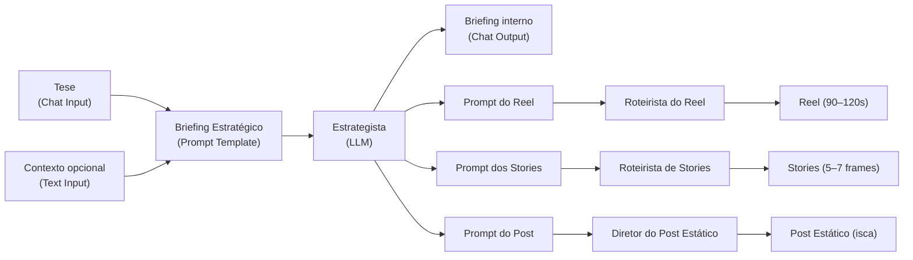

# Conteúdo Multiformato — Reel + Stories + Post estático

Fluxo Langflow que recebe **uma tese** e devolve **três peças irmãs**, cada uma adaptada ao seu formato:

| Peça | Formato | O que entrega |
|---|---|---|
| **Reel** | 90–120s (1,5–2 min) | Roteiro falado com timecodes, texto na tela, b-roll, prova, 3 passos e CTA |
| **Stories** | 5–7 frames, 45–60s | Roteiro frame a frame com enquete/quiz, virada, prova e CTA |
| **Post estático** | 1080×1350 (4:5) | Conceito visual, copy da imagem, legenda de 150–250 palavras, hashtags e CTA de palavra-chave |

As três peças compartilham a mesma tese, o mesmo ganho, a mesma resposta esperada, a mesma surpresa e a mesma prova. O que muda é a **adaptação ao formato**.

## Estrutura narrativa

Todas as peças seguem o mesmo arco:

```text
Gancho → Resposta esperada → Surpresa (virada + mecanismo) → Satisfação de expectativa (prova + entrega) → CTA
```

- **Gancho**: promessa específica nos primeiros 3 segundos (Reel) / primeiro frame (Stories) / headline (Post).
- **Resposta esperada**: o que o público provavelmente pensa. Gera identificação antes da virada.
- **Surpresa**: o mecanismo contraintuitivo que contraria a resposta esperada.
- **Satisfação**: a prova, os passos e o fechamento do loop aberto no gancho.
- **CTA**: uma ação única, específica e ligada ao ganho.

## Arquitetura



São **um estrategista + três roteiristas** (um pipeline multiagente determinístico). O estrategista fixa o ângulo; os três roteiristas não podem se contradizer porque recebem o mesmo briefing.

## Como importar

1. No Langflow, vá em **Projects** (ou na tela inicial) e use **Import Flow**.
2. Selecione `Conteudo Multiformato.json`.
3. Selecione o **mesmo modelo** nos quatro nós de LLM:
   - `Estrategista`
   - `Roteirista do Reel`
   - `Roteirista de Stories`
   - `Diretor do Post Estático`
4. Configure a **API key** do provider em **Settings → Providers** (ou no campo *API Key* de cada nó).
5. Abra o **Playground**, digite a tese e execute.
6. Leia as quatro saídas: **Briefing (interno)**, **Reel**, **Stories** e **Post Estático**.

> O campo **Contexto (opcional)** fica no canvas: use-o para marca, público, produto, tom de voz e provas disponíveis. Ele é enviado apenas ao estrategista.

## O que cada saída contém

### Reel

- Título interno, duração estimada e contagem de palavras faladas.
- Blocos com timecode: `[0–3s] GANCHO`, `[3–15s] RESPOSTA ESPERADA`, `[15–40s] SURPRESA + MECANISMO`, `[40–85s] SATISFAÇÃO + PROVA + 3 PASSOS`, `[85–110s] CTA`, `[110–120s] FECHAMENTO`.
- Para cada bloco: `FALA` e `TELA` (texto na tela / b-roll / corte).
- 225–300 palavras faladas, em ritmo de 140–160 palavras por minuto.

### Stories

- 5–7 frames, com duração por frame.
- `FALA`, `TEXTO NA TELA` (máx. 8 palavras), `O QUE MOSTRAR`, `STICKER/INTERAÇÃO` e `TRANSIÇÃO`.
- Frame 2 com enquete/quiz de 2 opções; frame 3 cita o resultado da enquete e revela a virada.
- Frame 6 com prova; frame 7 com CTA de palavra-chave.

### Post estático

1. **Conceito visual**: headline (≤ 7 palavras), subheadline, 3 bullets, elemento central, paleta/hierarquia, posição do CTA e regra de legibilidade.
2. **Copy da imagem**: o texto exato na ordem de leitura.
3. **Legenda**: 150–250 palavras com gancho, resposta esperada, surpresa, satisfação e CTA.
4. **Distribuição**: 8–12 hashtags, primeira resposta fixada e 2 headlines para teste A/B.

## Onde ajustar

| O quê | Onde |
|---|---|
| Voz, regras e formato de cada peça | Campo **System Message** dos quatro nós de LLM |
| Tarefa e variáveis dinâmicas | Nós **Prompt Template** (`{tese}`, `{contexto}`, `{estrategia}`) |
| Criatividade | **Temperature**: 0.4 (estrategista), 0.8 (Reel), 0.9 (Stories), 0.7 (Post) |
| Público, marca e provas | Nó **Contexto (opcional)** |
| Estrutura do briefing | JSON no System Message do **Estrategista** |

Se as três peças divergirem, ajuste o **briefing** — não os três roteiros. Ele é a fonte única de verdade.

## Checklist de qualidade

Antes de publicar, confira:

- [ ] O gancho promete um ganho específico e não é uma pergunta genérica.
- [ ] A resposta esperada é a crença real do público, não um espantalho.
- [ ] A surpresa contraria a resposta esperada e nomeia um mecanismo.
- [ ] A satisfação entrega a promessa com prova concreta (ou exemplo hipotético rotulado).
- [ ] A tese aparece com clareza nas três peças, com palavras diferentes.
- [ ] O Reel tem 225–300 palavras faladas e cabe em 90–120s.
- [ ] Os Stories têm enquete no frame 2 e citam o resultado no frame 3.
- [ ] O Post faz sentido sozinho e tem um CTA de palavra-chave.
- [ ] Nenhuma peça promete resultado garantido nem inventa números.

## Regenerar o JSON

O JSON é gerado por código, usando o `flow_builder` do `lfx` e o índice de componentes embutido — não precisa de servidor rodando:

```bash
uv run python flows/conteudo-multiformato/build_flow.py
```

O script reescreve `Conteudo Multiformato.json` ao lado dele. Edite os prompts no topo de `build_flow.py` e rode de novo para manter o JSON e o código em sincronia.

## Validação feita

- O payload passa em `FlowCreate` (modelo de importação do backend).
- `Graph.from_payload` constrói 14 vértices e 16 arestas (o nó de nota é ignorado pelo grafo).
- Execução ponta a ponta com `FakeListChatModel`: a tese digitada no `ChatInput` chega aos três prompts, o briefing é compartilhado e as três saídas são produzidas.
- Ainda **não** foi executado contra um provider real (o ambiente não tinha API key).

## Limitações

- Não pesquisa fatos nem valida dados na web. Se a tese não trouxer prova, o modelo pode usar um exemplo hipotético — ele é instruído a rotular isso.
- Não gera imagens, vídeos nem publica/agenda. A saída é roteiro + direção de arte.
- A qualidade depende do modelo. Use um modelo forte no **Estrategista** e no **Roteirista do Reel**; modelos pequenos podem ignorar o JSON ou estourar o tempo.
- O `ChatOutput` armazena mensagens. Para testar muitas teses, use uma sessão nova no Playground.

## Próximos passos possíveis

- **Prova real**: adicionar um `Agent` com **Web Search** antes do estrategista para buscar dados, cases e números.
- **Voz de marca**: conectar uma Knowledge Base (RAG) com tom de voz, ofertas e objeções.
- **Autoavaliação**: adicionar um LLM avaliador que pontua as três peças contra o checklist e pede revisão.
- **API/MCP**: expor o fluxo como endpoint para um calendário editorial.
- **Imagem**: gerar a arte do post e o storyboard a partir da direção de arte.
